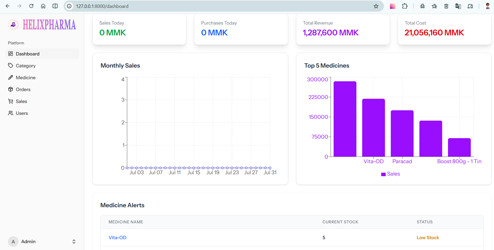
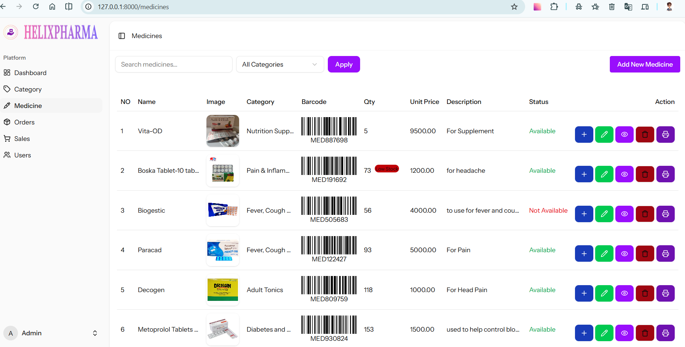
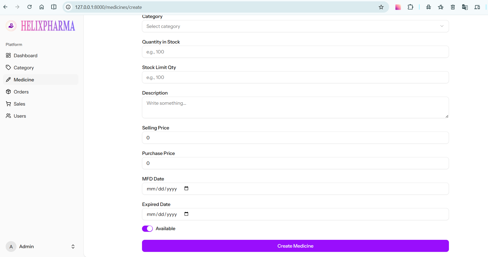
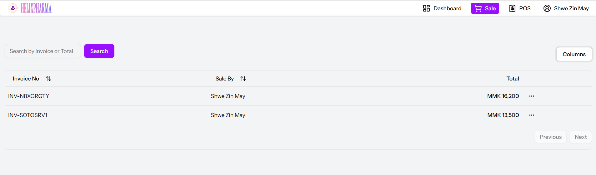
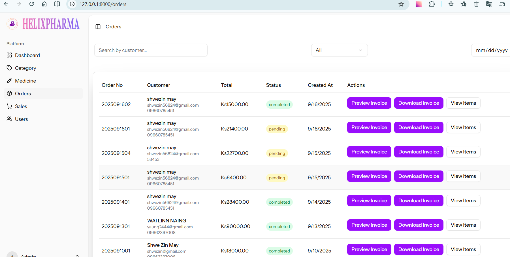
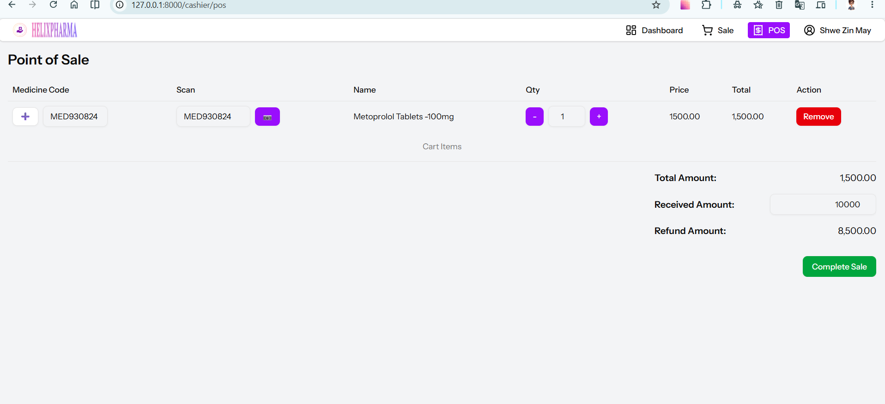
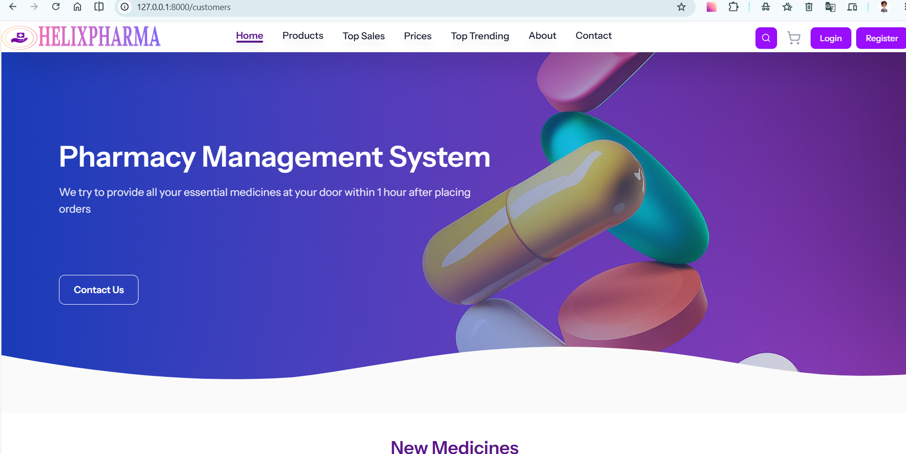
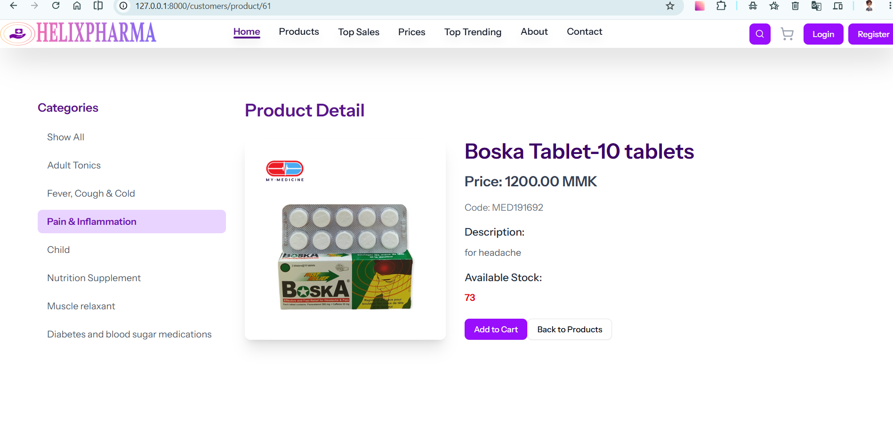
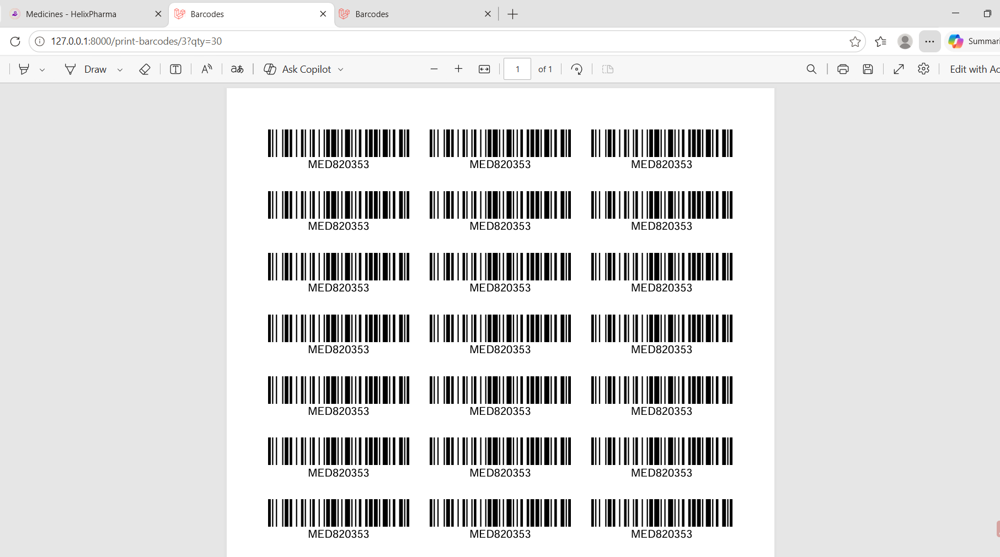

# MediStock


## Table of Contents

- [Overview](#overview)
- [Key Features](#key-features)
- [Tech Stack](#tech-stack)
- [Roles & Access Control](#roles--access-control)
- [Screenshots](#screenshots)
- [Project Structure](#project-structure)
- [Database Schema](#database-schema)
- [Installation & Setup](#installation--setup)
- [Configuration](#configuration)
- [Testing](#testing)
- [License](#license)

## Overview

MediStock is a complete pharmacy / medical supply management system. It combines a back-office admin panel (inventory, purchasing, sales, orders, users), a cashier point-of-sale terminal, and a public customer storefront with online ordering. Inventory is tracked using expiry-aware FIFO batch deduction, automatic Code-128 barcodes, and printable barcode labels. Analytics dashboards give staff real-time visibility into sales, purchases, revenue, and stock alerts.

## Key Features

- **Admin analytics dashboard** — KPI cards (Sales Today, Purchases Today, Total Revenue, Total Cost), daily sales line chart, Top 5 Medicines bar chart, and an alerts table.
- **Medicine inventory management** — full CRUD, categories, suppliers, and restocking via purchase batches with manufacture/expiry dates.
- **Auto-generated Code-128 barcodes** — per-medicine barcode plus a `/barcode/{code}` PNG route and printable PDF barcode labels.
- **FIFO inventory with expiry awareness** — batch deduction via `purchased_items` (skips expired batches) and FIFO stock restoration on order cancellation.
- **Medicine alerts** — Low Stock, Expired, and Near Expiry (within 30 days) notifications.
- **Shop sales & online orders** — manage shop sales (CSV/PDF export, shop vs online filter) and online orders with status updates (pending/completed/cancelled) that adjust stock and email invoices.
- **Cashier POS** — camera/QR barcode scanner + manual entry, cart, received/refund amounts, and invoice generation.
- **Customer storefront** — product browsing with search, category filter, and sorting (price low-high/high-low, top-selling, new-arrivals), product detail, cart (localStorage), and checkout.
- **Payments & invoices** — PDF invoices (DomPDF), Maatwebsite/Excel CSV/PDF export, and invoice emails via Laravel Mail.
- **Authentication** — Laravel Breeze-style auth, Google OAuth via Socialite, and a custom `role` middleware enforcing `users.role` access.

## Tech Stack

| Layer | Technology |
| --- | --- |
| Backend | Laravel 12, PHP ^8.2 |
| Database | SQLite (default), Eloquent ORM |
| Frontend | Inertia.js v2 + React 19 + TypeScript + Vite |
| Styling | Tailwind CSS v4 + shadcn/ui (Radix UI) + lucide-react |
| Charts | Recharts |
| Barcodes | picqer/php-barcode-generator (Code 128) + `/barcode/{code}` PNG route |
| PDF | barryvdh/laravel-dompdf (invoices + printable barcode labels) |
| Export | maatwebsite/excel (CSV/PDF) |
| Auth | Laravel Breeze + Laravel Socialite (Google OAuth) + custom `RoleMiddleware` |
| Utilities | Ziggy, framer-motion, sonner, react-qr-barcode-scanner, Mail |

## Roles & Access Control

The `users.role` column controls access via a custom `RoleMiddleware` (`admin` | `cashier` | `user`).

| Role | Capabilities |
| --- | --- |
| **Admin** | Dashboard analytics; Medicines CRUD + restock (purchase batches with mfd/exp dates); Categories, Suppliers, Medicine-Supplier preferred-supplier links; Shop Sales list/show with CSV/PDF export (shop vs online source filter); Online Orders management with status updates (pending/completed/cancelled) that deduct/restore stock FIFO and email invoices; Users management; Invoice preview/download PDF; Print barcode PDF labels. |
| **Cashier** | Cashier POS (camera/QR barcode scanner + manual code, cart, received/refund amount, complete sale → opens invoice); Cashier dashboard (same analytics); Sales list + sale detail/invoice. |
| **Customer** | Public storefront home/products (search, category filter, sort: price low-high/high-low/top-selling/new-arrivals); product detail; cart (localStorage) + checkout (name/email/phone/address/payment method/transaction id); My Orders; login/register (incl. Google OAuth); contact form. |

## Screenshots

### Admin


The admin dashboard presents KPI cards (Sales Today, Purchases Today, Total Revenue, Total Cost) in MMK, a daily sales line chart, a Top 5 Medicines bar chart, and a Medicine Alerts table highlighting Low Stock, Expired, and Near Expiry items.


The medicine inventory table lists medicines with stock levels, categories, prices, status badges, and quick actions to edit, restock, and print barcodes. Search, category filter, and sort controls are provided above the table.


The add/restock medicine form collects name, category, description, selling and purchase prices, initial quantity, stock limit, manufacture and expiry dates, image upload, and shows the auto-generated Code-128 barcode before saving.


The sales screen lists shop and online transactions with invoice numbers, cashier names, totals, and dates. It supports shop/online source filtering, month/year and date ranges, and CSV/PDF export. Clicking a row opens a detailed invoice view.


The online order management screen lets staff search and filter orders, update statuses (pending, completed, cancelled) which adjusts stock FIFO and sends invoice emails, and preview/download invoice PDFs.

### Cashier


The cashier point-of-sale terminal supports camera-based QR/barcode scanning and manual code entry, a live cart with quantity controls, automatic refund calculation, and sale completion that opens an invoice.

### Customer Storefront


The public storefront displays a hero/banner area, category navigation, and a responsive grid of product cards with images, prices, and Add to Cart actions. Search and filter controls allow customers to find medicines quickly.


The product detail page shows medicine information, quantity selector, and an Add to Cart button. A cart panel/checkout area collects customer shipping details, payment method, and transaction id for online orders.


The printable barcode label sheet displays Code-128 barcodes and medicine names in an A4 grid layout for physical inventory tagging.

## Project Structure

```
medical-supply-store/
├── app/
│   ├── Http/
│   │   ├── Controllers/        # Admin, Cashier, Customer, Barcode, Invoice controllers
│   │   ├── Middleware/         # RoleMiddleware (role-based access)
│   ├── Models/                 # User, Medicine, Category, Supplier, Sale, Order, PurchasedItem, ...
├── database/
│   ├── migrations/             # Schema migrations (users, medicines, purchases, sales, orders, ...)
│   ├── seeders/                # DatabaseSeeder.php (roles assigned manually)
├── resources/
│   ├── js/
│   │   ├── pages/              # Inertia/React pages (admin, cashier, storefront)
│   │   ├── views/              # PDF/invoice/email Blade templates
├── routes/
│   ├── web.php                 # Web + Inertia + /barcode/{code} routes
│   ├── auth.php                # Auth + Socialite (Google) routes
├── screenshots/                # UI screenshots (PNG)
└── README.md
```

## Database Schema

| Table | Purpose |
| --- | --- |
| `users` | Staff (admin/cashier) and customers; includes the `role` column. |
| `categories` | Medicine categories. |
| `suppliers` | Medicine suppliers. |
| `medicines` | Medicines: name, category_id, price, qty, stock_limit, status, image, medicine_barcode. |
| `purchased_items` | Purchase batches: medicine_id, qty, sold_qty, unit_price, mfd_date, exp_date. |
| `sales` | Shop sales: invoice_no, sale_by, total, received, refund. |
| `sale_items` | Items within a shop sale. |
| `orders` | Online orders: user_id, order_no, total, status, contact fields, payment_method, transaction_id. |
| `order_items` | Items within an online order. |
| `order_item_stocks` | FIFO restoration tracking for cancelled/returned orders. |
| `medicine_supplier` | Preferred-supplier links between medicines and suppliers. |

**FIFO / batch note:** Inventory is deducted using first-in-first-out batch logic from `purchased_items`. Expired batches (by `exp_date`) are skipped during deduction. Cancelling or reversing an order restores stock FIFO via `order_item_stocks`.

## Installation & Setup

```bash
# 1. Copy environment configuration
cp .env.example .env

# 2. Install PHP dependencies
composer install

# 3. Install JS dependencies
npm install

# 4. Generate application key
php artisan key:generate

# 5. Run migrations (database/database.sqlite already exists;
#    if not, run: touch database/database.sqlite)
php artisan migrate

# 6. Link storage for medicine images
php artisan storage:link
```

Run the development environment:

```bash
# All-in-one (serves app + queue listener + Vite together)
composer dev

# Or run separately:
php artisan serve
npm run dev
```

Create users and set their `role` column (`admin` / `cashier` / `user`) via Tinker or a seeder:

```bash
php artisan tinker
# Only DatabaseSeeder.php exists by default, so assign roles manually.
```

## Configuration

Key `.env` settings:

- `DB_CONNECTION=sqlite` — the application uses SQLite by default.
- `MAIL_MAILER=log` — emails (invoices, etc.) are logged by default; configure a real mailer to send.
- **Optional Google OAuth** — add the following to enable Socialite login:
  ```
  GOOGLE_CLIENT_ID=your-client-id
  GOOGLE_CLIENT_SECRET=your-client-secret
  GOOGLE_REDIRECT_URI=your-redirect-uri
  ```

## Testing

```bash
composer test        # Runs the Pest test suite
./vendor/bin/pint    # Formats the codebase
```

## License

MediStock is open-sourced software licensed under the [MIT License](https://opensource.org/licenses/MIT).
